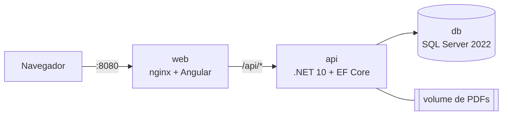

# Assistant Support

        

O objetivo era resolver um problema simples, um "chatbot de IA" para auxiliar o dia a dia de um time de analistas de suporte. 

Durante o planejamente foi pensado em criar uma base com diversos documentos e procedimentos de uma empresa e criar um agente que consultasse antes de gerar uma resposta, porém haviam dois problemas, comprometer dados internos de uma empresa e ferir leis de proteção de dados.

Outra alterativa era um "Rag", o que era complexo demais e iria gerar um consumo de tokens desnecessáro.

Então decidi o caminho mais simples, cadastrar procedimentos de forma manual, e a interface se comportando como um chatbot, reconhecendo intenções e renderizando respostas prontas.

**Sem IA:** a busca é determinística (texto normalizado + palavras-chave e sinônimos), e toda resposta vem do que foi cadastrado no painel admin.

## Arquitetura



| Camada | Tecnologia |
| --- | --- |
| Front | Angular 22 + Tailwind CSS 4, servido pelo nginx |
| API | .NET 10 Minimal APIs, organizada por features (`api/src/AssistantSupport.Api/Features`) |
| Banco | SQL Server 2022 via EF Core (migrations aplicadas ao subir) |
| Infra | Docker Compose com 3 serviços: `web`, `api` e `db` |

O navegador fala só com o nginx, que entrega o Angular e repassa `/api` para a API. A autenticação usa cookie HttpOnly com proteção CSRF.

## Rodando localmente

Pré-requisito: [Docker Desktop](https://www.docker.com/products/docker-desktop/).

```bash
# 1. Baixe o projeto
git clone https://github.com/pabloquirino/support-assistant.git
cd support-assistant

# 2. Crie o .env a partir do modelo
cp .env.example .env
```

Preencha no `.env`:

```env
SA_PASSWORD=Senha#Forte123      # 8+ caracteres com maiúscula, minúscula, número e símbolo
ADMIN_EMAIL=admin@local.test
ADMIN_PASSWORD=sua-senha
```

```bash
# 3. Suba tudo
docker compose up -d --build
```

Acesse **http://localhost:8080** e entre com o e-mail e a senha do admin. O banco já vem com conteúdo de exemplo.

Para parar, rode `docker compose down`. Com `docker compose down -v`, os dados também são apagados.

## Desenvolvimento sem Docker

Requer .NET SDK 10 e Node.js 22+.

```bash
docker compose up -d db                       # só o banco

cd api/src/AssistantSupport.Api
dotnet user-secrets init
dotnet user-secrets set "Admin:Email" "admin@local.test"   # admin inicial
dotnet user-secrets set "Admin:Password" "sua-senha"
dotnet run --urls http://localhost:5000       # API

cd web
npm ci
npx ng serve --proxy-config proxy.conf.json   # front em http://localhost:4200
```
